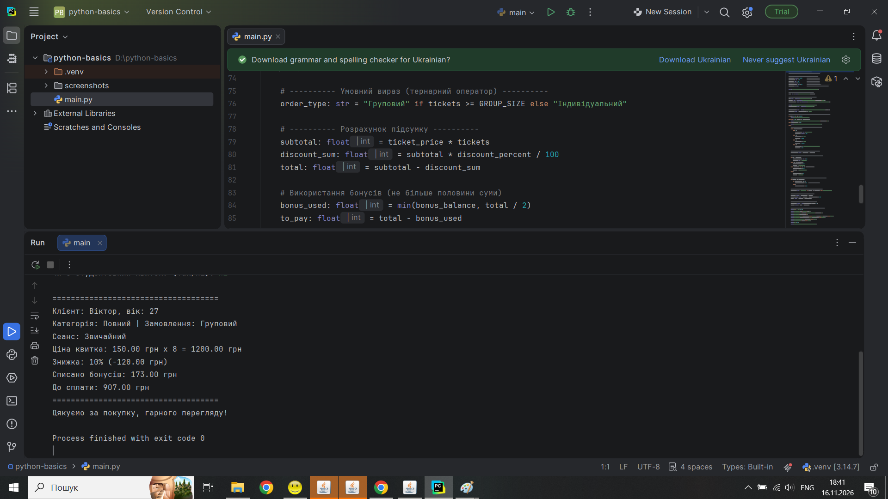

# Калькулятор вартості квитків у кінотеатр

## Призначення програми
Консольна програма на Python, яка приймає дані відвідувача, розраховує
вартість квитків з урахуванням знижок і виводить відформатований чек.

## Основні можливості
- Введення імені, віку, кількості квитків, типу сеансу та бонусного балансу.
- Перевірка коректності введених даних.
- Розрахунок знижок: дитячий, пільговий, студентський квиток, груповий.
- Доплата за формат сеансу (звичайний, 3D, VIP).
- Списання бонусів (не більше 50% суми).
- Виведення зрозумілого чека.

## Використані технології
- Python 3.10+
- Git та GitHub
- PyCharm / Visual Studio Code

## Конструкції Python, які були використані
- Змінні та типи `int`, `float`, `str`, `bool`
- Константи та анотації типів
- `input()`, `print()`
- Перетворення `int()`, `float()`, `str()`
- f-рядки
- Математичні операції
- Оператори порівняння та логічні `and`, `or`, `not`
- Умови `if`, `elif`, `else`
- Вкладені умови
- Умовний вираз (`... if ... else ...`)
- `match-case`
- Коментарі

## Інструкція із запуску
1. Встановіть Python 3.10 або новіший.
2. Клонуйте репозиторій:
   ```bash
   git clone https://github.com/everdream111/python-basics.git
   cd python-basics
   ```
3. Запустіть програму:
   ```bash
   python main.py
   ```

## Приклад введення та результату

**Введення:**
```
Введіть ваше ім'я: Олена
Введіть ваш вік: 20
Кількість квитків (1-10): 5
Бонусний баланс, грн (0 якщо немає): 100
Ваш вибір: 2
Чи є студентський квиток? (так/ні): так
```

**Результат:**
```
====================================
Клієнт: Олена, вік: 20
Категорія: Студентський | Замовлення: Груповий
Сеанс: 3D
Ціна квитка: 190.00 грн x 5 = 950.00 грн
Знижка: 30% (-285.00 грн)
Списано бонусів: 100.00 грн
До сплати: 565.00 грн
====================================
Дякуємо за покупку, гарного перегляду!
```

## Скріншоти виконання програми


